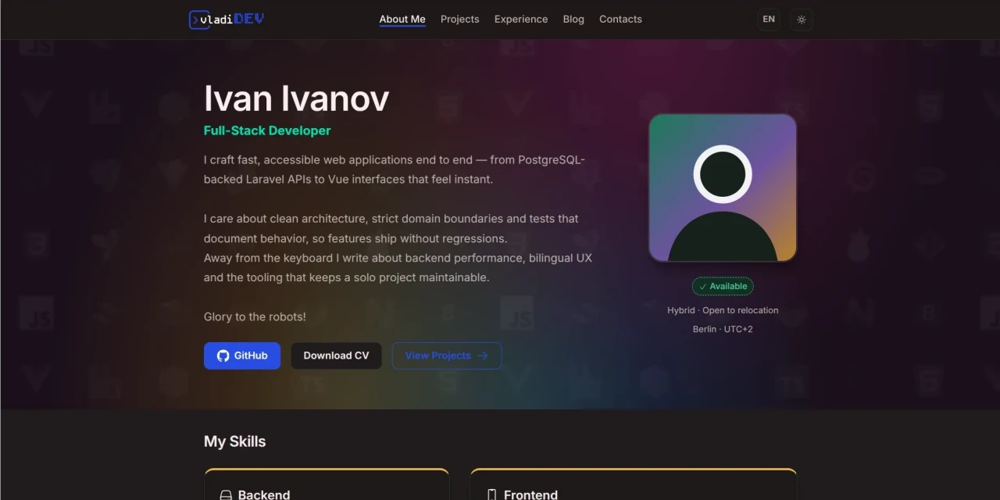

<p align="center">
  
  
</p>

# Портфолио

[](https://github.com/dajnz/portfolio/actions/workflows/ci.yml)
[](https://www.php.net/)
[](https://laravel.com/)
[](https://vuejs.org/)
[](https://www.typescriptlang.org/)
[](../../LICENSE)

[English](../../README.md) | **Русский**

Персональное портфолио и блог-платформа: двуязычный публичный сайт (английский
и русский) и собственная админ-панель для управления контентом, аналитикой,
генерацией резюме и резервными копиями. Создано с использованием подхода на базе
агентской разработки с ручной проверкой кода.

> Проект готовится к первому публичному релизу; живого развёртывания пока нет.

## Возможности

### Публичный сайт

- Главная страница с hero-секцией, навыками, избранными проектами, последними
  статьями и контактами.
- Каталог проектов с отдельными страницами, техническими описаниями и
  связанными навыками.
- Хронология опыта.
- Блог с полнотекстовым поиском, фильтрацией по тегам, похожими статьями,
  реакциями, оглавлением и RSS-лентой.
- Генерация PDF-резюме по адресу `/cv` из того же контента, что и сайт.
- Английский и русский маршруты (`/` и `/ru`), тёмная и светлая темы.
- SEO: локализованные мета-теги, JSON-LD, hreflang-альтернативы, карта сайта и
  `robots.txt`.
- Аналитика с бережным отношением к приватности: IP-адреса хешируются.

### Админ-панель

- Аутентификация по сессии с TOTP, кодами восстановления и опциональным GitHub
  OAuth.
- CRUD для статей блога, тегов, проектов, опыта, навыков и контактов, а также
  обработка обратной связи.
- Массовые действия, мягкое удаление и восстановление, drag-and-drop сортировка
  и предпросмотр по подписанным ссылкам.
- Markdown-редактор с загрузкой изображений и автоматической конвертацией в
  WebP.
- Дашборд аналитики с ежедневными метриками, графиками и рейтингами.
- Редактор резюме с предпросмотром и кешируемой генерацией PDF.
- Зашифрованные резервные копии базы данных и файлов, восстановление и импорт
  для аварийного восстановления.
- Настройки и флаги функций.

## Технологии

| Слой | Технологии |
| --- | --- |
| Бэкенд | PHP 8.5, Laravel 13, PostgreSQL 18, Redis 8 |
| Фронтенд | Vue 3, Inertia.js 3, TypeScript, Vite 8, Tailwind CSS 4 (админка), BEM + scoped CSS (публичный сайт) |
| Контент | CommonMark, Shiki и highlight.php, Intervention Image, S3-совместимый RustFS |
| Инфраструктура | Docker Compose, nginx, Docker Swarm, Ansible |
| Качество | Pest 4, Vitest 4, Playwright, Biome, ESLint, Stylelint, Pint, Spectral, Lighthouse CI |

## Архитектура

Приложение — модульный монолит. Каждая фича находится в
`app/Features/{Feature}/` и разделена на слои `Domain`, `App` и `Infra`.
Доменный слой не зависит от фреймворка, а чтения между фичами идут через
контракты `Shared`.

HTTP-поверхность описана по принципу OpenAPI-first в
[`docs/openapi`](../../docs/openapi/README.md): спецификации — источник истины,
а TypeScript-типы генерируются из них. Публичные страницы работают на Inertia +
Vue с серверным рендерингом. Устойчивые архитектурные решения зафиксированы в
[ADR](../../docs/adr/README.md).

## Быстрый старт

**Требования**:
- Docker Engine с плагином Compose;
- GNU Make (для запуска команд);
- тестировалось только под Ubuntu 24.04.

Сервисы PHP, Node, PostgreSQL, Redis и S3-совместимое хранилище работают в контейнерах.

**Важное замечание**: Docker должен быть сконфигурирован так, чтобы можно было запускать его команды без использования SUDO.
Чтобы сделать это, можно использовать следующий код:

```bash
# Добавляет текущего пользователя в группу docker, это приемлемо только для локальной разработки.
# Не используйте это на реальных серверах, т.к. такой подход имеет свои последствия в плане безопасности.
sudo usermod -aG docker $USER
# Запускает новую оболочку (shell) с другой основной группой (в донном случае это группа docker)
newgrp docker
```
```
```

Используйте следующие команды для быстрого старта:

```bash
git clone https://github.com/dajnz/portfolio.git
cd portfolio
make setup
```

`make setup` собирает контейнеры, устанавливает PHP- и Node-зависимости,
собирает фронтенд, выполняет миграции, добавляет демо-контент, создаёт первого
администратора (команда запросит учётные данные) и создаёт тестовую базу.

- Публичный сайт: <http://localhost:8888>
- Админ-панель: <http://localhost:8888/admin>

По умолчанию используется localhost-режим — DNS и обратный прокси не нужны.
TLS-режим с Traefik доступен через `make up` для хостов, где настроен
`portfolio.dev.lan`.
Настройка локального окружения с поддержкой TLS не является частью данного проекта.

Сидеры создают вымышленный демо-контент; замените его в админ-панели.

## Основные команды

| Команда | Описание |
| --- | --- |
| `make up-localhost` | Запустить localhost-стек на <http://localhost:8888> |
| `make down-localhost` | Остановить и удалить localhost-стек |
| `make seed-fresh` | Пересоздать базу, добавить демо-контент и администратора |
| `make admin-create` | Создать администратора |
| `make test` | Запустить наборы тестов Pest и Vitest |
| `make test-e2e` | Запустить end-to-end тесты Playwright |
| `make coverage` | Запустить оба набора с порогом покрытия бэкенда 80% |
| `make lint` | Запустить Pint, Biome, ESLint, Stylelint и Spectral |
| `make typecheck` | Сгенерировать типы API и запустить `vue-tsc` |
| `make lighthouse` | Проверить бюджеты Lighthouse на шести публичных страницах |
| `make open-dev` | Открыть оболочку в dev-контейнере |

## Тестирование

- Тесты бэкенда работают с настоящей базой PostgreSQL, а не с SQLite.
- `make test` запускает Pest и Vitest; `make test-e2e` запускает Playwright на
  изолированной базе и отдельном экземпляре приложения.
- `make coverage` требует не менее 80% покрытия строк бэкенда.
- CI повторяет локальные цели: линтинг, проверку типов, тесты бэкенда и
  фронтенда, end-to-end тесты и бюджеты Lighthouse.

## Структура проекта

```text
app/Features/       Модули фич (Domain / App / Infra)
docs/openapi/       Контракты OpenAPI и page-props для Inertia
docs/adr/           Записи архитектурных решений
docs/readme/        Перевод README и его ресурсы
resources/js/       Фронтенд на Vue 3 + TypeScript
resources/css/      Публичные дизайн-токены и BEM-стили
devops/             Docker-образы, развёртывание и инструменты
tests/              Наборы тестов Pest, Vitest и Playwright
```

## Развёртывание

Развёртывание выполняется вручную и вне CI. CI лишь поддерживает
`devops/deploy/manifest.yml` — манифест тегов образов для каждого сервиса: при
каждом пуше в `main`, прошедшем быстрые тесты, бот пересчитывает теги и
коммитит манифест.

Поскольку коммит манифеста появляется после коммита с кодом, разворачивайте из
`main` (вершина включает манифест) или создавайте релизный тег после завершения
задачи обновления манифеста:

```bash
make deploy GIT_REF=main
```

Продакшен — это стек Docker Swarm, разворачиваемый через Ansible. Секреты не
хранятся в репозитории и задаются на хосте. Ветка `main` защищена набором
правил, который требует прохождения проверок CI.

## Участие в разработке

Это личный проект, поэтому новые фичи развивает владелец. Сообщения об ошибках
и точечные исправления приветствуются — для нетривиальных изменений сначала
откройте issue.

## Благодарности

Проект построен на [Laravel](https://laravel.com/), [Vue](https://vuejs.org/) и
[Inertia.js](https://inertiajs.com/). Шрифты Inter и JetBrains Mono подключены
через [Bunny Fonts](https://fonts.bunny.net/) по лицензии SIL Open Font License;
иконки взяты из наборов Heroicons, Lucide, Simple Icons и Devicon.

## Лицензия

[MIT](../../LICENSE) © 2026 Vladimir Ponomarev.
